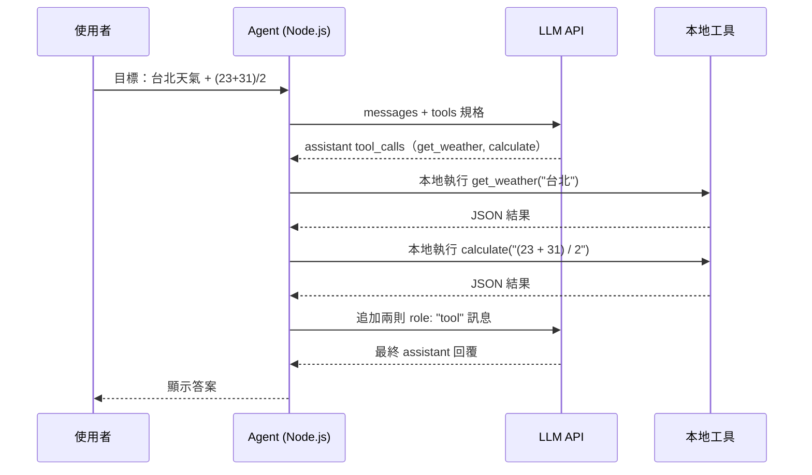

# 從 LLM API 到手刻一個 AI Agent

> 現代軟體工程 Hw11（week12）：不依賴任何第三方套件，用純 Node.js 內建 `fetch` 走完「單次呼叫 → Chatbot → Tool Calling → Agent Loop」的完整進化路線。

---

## 演進路線圖

```mermaid
flowchart LR
    A[單次 LLM API<br/>f(messages) → message] --> B[Chatbot<br/>history 陣列形成多輪對話]
    B --> C[Tool Calling<br/>模型輸出意圖，本地執行工具]
    C --> D[AI Agent<br/>ReAct 迴圈自主規劃與終止]
```

---

## 第 1 章：LLM API 的本質——一台無狀態的文字接龍機

把 LLM API 想成一個純函數會最容易理解：

```text
f(messages) → message
```

你送出一份 `messages` 陣列，它回傳下一個 `assistant` 訊息。API 本身**不會記得**你上一次呼叫說了什麼；每一次請求都是全新的、stateless 的。使用者感受到的「記憶」，其實是用戶端把舊訊息重新貼進下一次請求所製造出來的假象。

常見角色（role）語意：

| role | 用途 |
| :--- | :--- |
| `system` | 設定人格、語氣、輸出格式與安全邊界，優先權最高 |
| `user` | 使用者真正的問題或指令 |
| `assistant` | 模型過去的回覆；再次送回時讓模型知道之前說過什麼 |
| `tool` | 本地工具執行完的結果，用 `tool_call_id` 對應到某一次工具呼叫 |

真實請求 JSON（對應本實作 `requestChatCompletion()`）：

```json
{
  "model": "gpt-4o-mini",
  "messages": [
    { "role": "system", "content": "你是一位簡潔的助理" },
    { "role": "user", "content": "台北天氣如何？" }
  ],
  "temperature": 0.2,
  "tools": [
    {
      "type": "function",
      "function": {
        "name": "get_weather",
        "description": "查詢指定城市的本地示範天氣資料（離線、不需聯網）",
        "parameters": {
          "type": "object",
          "properties": {
            "city": { "type": "string", "description": "城市名稱，例如：台北、金門" }
          },
          "required": ["city"],
          "additionalProperties": false
        }
      }
    }
  ],
  "tool_choice": "auto"
}
```

真實回應 JSON 的骨架：

```json
{
  "id": "chatcmpl-abc123",
  "choices": [
    {
      "index": 0,
      "message": { "role": "assistant", "content": "台北目前多雲時晴，約 27°C。" },
      "finish_reason": "stop"
    }
  ],
  "usage": { "prompt_tokens": 86, "completion_tokens": 18, "total_tokens": 104 }
}
```

`finish_reason` 是走到 Agent 迴圈的關鍵訊號：`stop` 代表模型已完成回答；`tool_calls` 代表模型想要呼叫工具，控制權暫時交還給本地程式。

**核心重點總結：LLM API 沒有記憶，它只根據你這一次送進去的完整 `messages` 產生下一個訊息。**

---

## 第 2 章：Chatbot 的記憶真相——`history` 陣列與成本

Chatbot 的「記憶」其實只是一份自己維護的 `history` 陣列：

```js
const history = [{ role: "system", content: "你是一位簡潔的助理" }];

async function chat(userText) {
  history.push({ role: "user", content: userText });
  const reply = await callLLM(history);
  history.push({ role: "assistant", content: reply });
  return reply;
}
```

每問一句就長兩則訊息。API 每次都要重新讀取整段歷史，因此成本有兩個面向：

- **Token 成本**：計價以 input + output token 計算。第 n 輪要把前 n-1 輪全部重送，總消耗近似 O(n²)。
- **Context Window**：模型可讀取的 token 上限有限。歷史太長會被截斷、忽略，甚至擠掉 `system` 指令。

實務上的壓縮手法：

1. **滑動視窗**：只保留最近 k 輪對話。
2. **摘要壓縮**：請模型把舊對話整理成一則濃縮的 `assistant` 摘要，取代原始十幾則訊息。
3. **工具結果裁剪**：天氣、搜尋這類龐大 payload 用完即丟或只留重點欄位（本專案的 `role: "tool"` 訊息就是很小的一段 JSON）。
4. **擷取式記憶（RAG）**：把舊內容放到外部資料庫，需要時才撈相關片段放進脈絡，而非全部塞進訊息裡。

**核心重點總結：Chatbot 的記憶是用戶端反覆重送的 `history`，既是成本來源，也是 context window 的天花板。**

---

## 第 3 章：Tool Calling——模型只給意圖，程式才真的做事

最常見的誤解是「LLM 幫我查了天氣、算了數學」。事實上模型**沒有執行任何程式**：它只從 `tools` 規格中挑一個函式，產出 `{ name, arguments }` 的結構化意圖；真正的計算、查詢、資料庫寫入全部由我們自己的 Node.js 程式在本地執行，再把結果以 `role: "tool"` 送回模型。

### 時序圖



### 三種真實 JSON 格式

**1. 提供給模型的工具規格（`tools`，OpenAI Chat Completions 格式）**

```json
[
  {
    "type": "function",
    "function": {
      "name": "calculate",
      "description": "安全解析並計算四則運算式，支援括號、小數點與負數，不使用 eval",
      "parameters": {
        "type": "object",
        "properties": { "expression": { "type": "string" } },
        "required": ["expression"],
        "additionalProperties": false
      }
    }
  }
]
```

**2. 模型回傳的工具呼叫意圖（`tool_calls`）**

```json
{
  "role": "assistant",
  "content": "我需要先取得天氣與計算結果，才能完整回答使用者。",
  "tool_calls": [
    {
      "id": "call_mock_1",
      "type": "function",
      "function": { "name": "get_weather", "arguments": "{\"city\":\"台北\"}" }
    },
    {
      "id": "call_mock_2",
      "type": "function",
      "function": { "name": "calculate", "arguments": "{\"expression\":\"(23 + 31) / 2\"}" }
    }
  ]
}
```

**3. 本地執行後回傳的觀察（`role: "tool"`）**

```json
{
  "role": "tool",
  "tool_call_id": "call_mock_2",
  "name": "calculate",
  "content": "{\"ok\":true,\"data\":{\"expression\":\"(23 + 31) / 2\",\"result\":27}}"
}
```

`tool_call_id` 是把結果「還給正確提問」的識別證；少了它，模型無法判斷這段結果對應哪一次呼叫。

本實作的 `calculate()` 刻意**不使用 `eval`**，而是用 tokenizer + 遞迴下降解析器（expression → term → factor），只接受數字、`+ - * / ( )` 與小數點，並阻擋除數為 0、多餘符號與過長輸入。`get_weather()` 則是完全離線的本地示範資料，不會偽裝成真實氣象服務。

**核心重點總結：Tool Calling 是「模型出意圖、本地執行、結果回灌」的協定，模型本身沒有碰過你的程式或資料庫。**

---

## 第 4 章：Agent Loop——ReAct 迴圈與 `maxSteps` 防呆

Agent = LLM + 工具 + **自主控制流程**。核心就是一個「思考 → 行動 → 觀察」的 ReAct 迴圈：

```js
async function runAgent(goal, maxSteps = 6) {
  const messages = [{ role: "user", content: goal }];

  for (let step = 1; step <= maxSteps; step += 1) {
    const reply = await askLLM(messages);
    messages.push(reply);

    if (reply.tool_calls.length === 0) return reply.content;

    for (const call of reply.tool_calls) {
      const result = executeLocalTool(call);
      messages.push({
        role: "tool",
        tool_call_id: call.id,
        name: call.function.name,
        content: JSON.stringify(result)
      });
    }
  }
  return "已達 maxSteps 上限，強制停止。";
}
```

四個設計要點：

1. **終止條件**：沒有 `tool_calls` 就代表模型給出最終答案，可以結束迴圈。
2. **狀態累積**：助理訊息與工具訊息都放進同一個 `messages`，下一輪模型因此能「看到」剛剛的觀察結果。
3. **`maxSteps` 防呆**：模型可能反覆呼叫同一個工具或陷入來回糾錯；用上限強制煞車，避免無限請求與帳單爆量。
4. **工具錯誤也是觀察**：本範例把 `{ ok: false, error: "除數不可為 0" }` 照樣回灌，讓模型有機會自我修正，而不是讓整個行程崩潰。

在 `agent_demo.js` 中，`--mock` 模式會模擬模型先回傳兩個 `tool_calls`、看到兩則 `role: "tool"` 後再回傳最終答案，因此可以在沒有 API Key 的環境下逐 step 驗證整套訊息結構。

**核心重點總結：Agent 的本質是把 LLM 放進有終止條件的 while/for 迴圈，讓模型能看見工具結果並決定下一步。**

---

## 第 5 章：實戰級 Agent 的三大拼圖

一個能上台的 Agent，除了上面的迴圈，還需要三塊拼圖：

### 1. RAG 長期記憶

把文件、歷史事件切塊後做向量索引。Agent 遇到問題先檢索相關片段，再將片段放進 `messages`，讓模型「記得」(context window 之外的知識)。它解決的是「模型不知道你公司的規格書」而不是「模型忘記上一句話」。

### 2. Human-in-the-loop 權限確認

讀取資料可以自動化，但轉帳、刪資料庫、寄信這類**不可逆動作**必須先請人類按一次同意。實作上是在 `executeLocalTool()` 前插入確認關卡，並保留工具名稱、參數與預期影響的審查紀錄。

### 3. Error Feedback Loop 容錯自我修正

工具失敗時不要把 exception 直接往外丟。把結構化錯誤（例如 `{ ok: false, error: "除數不可為 0" }`）當成新的 observation 回灌，模型就能改口要求 `10 / 2` 或換一個工具。搭配重試上限與 `maxSteps`，才不會形成「越修越錯」的死迴圈。

### 為什麼先手刻，再學框架？

框架（LangChain、LangGraph 等）幫你處理了串接、retry、trace，但也把 `messages` 的細節藏起來。先手刻一次，你才會知道：誰在執行工具、為什麼要 `tool_call_id`、何時該截斷歷史、錯誤該怎麼回灌。理解協定之後再用框架，是在管理複雜度；不理解就用框架，是在猜黑箱。

**核心重點總結：RAG 補知識、HITL 補安全、Error Feedback 補韌性，而先手刻才能看穿框架背後真正發生的事。**

---

## 四階段能力比較總表

| 能力維度 | 單次 LLM API | Chatbot | Tool Calling | AI Agent |
| :--- | :--- | :--- | :--- | :--- |
| 記憶 | 無，每次呼叫重新開始 | `history` 陣列形成多輪對話 | 多輪訊息＋工具結果 | 完整訊息軌跡可在每一步累積 |
| 外部世界 | 不能 | 不能 | 能，但需由模型提出意圖 | 能，且能連續呼叫多個工具 |
| 控制流程 | 呼叫一次就結束 | 使用者逐輪驅動 | 模型一次可要求多個工具 | 模型自主決定何時停止、何時再行動 |
| 程式誰執行 | 無 | 無 | 本地程式執行，模型不執行 | 本地程式執行，模型只調度 |
| 成本風險 | 低 | 隨輪數近似 O(n²) 成長 | 工具 payload 會增加 token | 迴圈失控可能大量呼叫，需 `maxSteps` |
| 典型風險 | 幻覺 | context 截斷、帳單成長 | 參數竄改、工具副作用 | 無限迴圈、誤觸高風險操作 |
| 適用場景 | 翻譯、摘要、分類 | 客服問答、陪伴 | 查天氣、查資料庫、算數 | 研究助理、自動化工作流程 |

---

## 實作驗證

### 檔案

```text
Homework/Hw11(week12)/
├── agent_demo.js   # 純 Node.js Agent：本地工具、TOOLS_SPEC、runAgent、mock/API 雙模式
└── README.md       # 本文件
```

### 執行方式

```bash
# 離線模擬模式（不需要 API Key，推薦先跑這個）
node Homework/Hw11(week12)/agent_demo.js --mock

# 有 API Key 時的真實模式
set OPENAI_API_KEY=你的金鑰
set OPENAI_BASE_URL=https://api.openai.com/v1
set LLM_MODEL=gpt-4o-mini
node Homework/Hw11(week12)/agent_demo.js --goal "請告訴我金門的天氣，並計算 12 * 3 + 4"

# 未設定 OPENAI_API_KEY 時，不加 --mock 也會自動提示並切到模擬模式
node Homework/Hw11(week12)/agent_demo.js
```

### 實際終端機輸出紀錄（Node.js v24.15.0）

執行指令：

```bash
node Homework/Hw11(week12)/agent_demo.js --mock
```

輸出：

```text
================================================================
🧪 目前為離線模擬模式（MOCK），未呼叫任何外部 API
================================================================
🎯 目標：請告訴我台北的天氣，並幫我計算 (23 + 31) / 2 的結果。

--- Step 1 / 6 ---
🧠 模型回覆：我需要先取得天氣與計算結果，才能完整回答使用者。
🔧 tool_calls：
[
  {
    "id": "call_mock_1",
    "type": "function",
    "function": {
      "name": "get_weather",
      "arguments": "{\"city\":\"台北\"}"
    }
  },
  {
    "id": "call_mock_2",
    "type": "function",
    "function": {
      "name": "calculate",
      "arguments": "{\"expression\":\"(23 + 31) / 2\"}"
    }
  }
]
⚙️  本地執行 get_weather：{"ok":true,"data":{"city":"台北","source":"本地示範資料","condition":"多雲時晴","temperatureC":27,"humidity":68}}
📨 回傳 role: "tool" 訊息：
{
  "role": "tool",
  "tool_call_id": "call_mock_1",
  "name": "get_weather",
  "content": "{\"ok\":true,\"data\":{\"city\":\"台北\",\"source\":\"本地示範資料\",\"condition\":\"多雲時晴\",\"temperatureC\":27,\"humidity\":68}}"
}
⚙️  本地執行 calculate：{"ok":true,"data":{"expression":"(23 + 31) / 2","result":27}}
📨 回傳 role: "tool" 訊息：
{
  "role": "tool",
  "tool_call_id": "call_mock_2",
  "name": "calculate",
  "content": "{\"ok\":true,\"data\":{\"expression\":\"(23 + 31) / 2\",\"result\":27}}"
}

--- Step 2 / 6 ---
🧠 模型回覆：根據工具觀察結果，台北 天氣為多雲時晴，氣溫約 27°C，濕度 68%；(23 + 31) / 2 = 27。以上數值皆由本地工具產生，未呼叫任何外部服務。
✅ 最終回覆：
根據工具觀察結果，台北 天氣為多雲時晴，氣溫約 27°C，濕度 68%；(23 + 31) / 2 = 27。以上數值皆由本地工具產生，未呼叫任何外部服務。

📊 完成：共 2 個 step、2 輪模型請求、5 則訊息。
```

從 log 可以逐項驗證：Step 1 模型只給出工具意圖；本地確實執行了兩個工具並回傳 `role: "tool"`；Step 2 模型讀到觀察結果後才給最終答案，總共 2 個 step、5 則訊息（1 user + 1 assistant + 2 tool + 1 assistant）。

---

## 學習心得

這次最關鍵的收穫是發現「AI Agent」並不是什麼神秘技術，而是把無狀態的 API 包進一個有終止條件的迴圈，並用結構化訊息把工具結果接回模型。寫完 `calculate()` 的解析器後，也更能體會為什麼工具邊界不可省略：`eval` 看似方便，卻等於把程式碼執行權交給模型輸出。未來若要接真實服務，我會先補上 HITL 確認與錯誤回灌，再把這套手刻流程遷移到框架，而不是一開始就讓框架替我決定所有細節。
