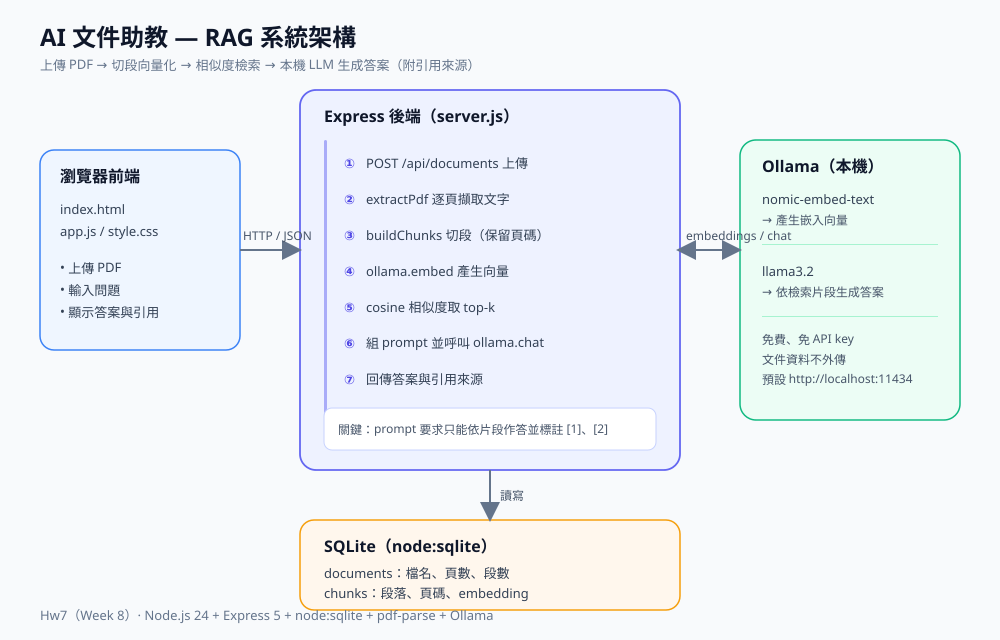

# AI 文件助教（Hw7 / Week 8）

一套以 **RAG（Retrieval-Augmented Generation）** 為核心的 PDF 問答系統。上傳講義或論文後，可以用自然語言提問，回答會標註 **引用來源編號與頁碼**，方便回頭核對原文，降低 LLM 幻覺。

- 全程使用 **本機 Ollama**：免費、免 API key、文件不外傳。
- 後端零原生資料庫依賴：使用 Node.js 內建的 `node:sqlite`。
- 延續 Hw2 的三層架構、Hw3 的前端互動、Hw6 的測試思維。

## 功能

| 功能 | 說明 |
|------|------|
| PDF 上傳與索引 | 解析文字、依頁切段、產生向量並存入 SQLite |
| 自然語言問答 | 針對選定文件提問，回傳繁體中文答案 |
| 引用來源 | 每則回答附上來源編號、頁碼、相似度與原文片段 |
| 文件庫管理 | 列出所有文件（頁數／段數／大小）、可刪除 |
| 健康檢查 | 自動偵測 Ollama 是否啟動、模型是否已下載 |
| 錯誤提示 | Ollama 未啟動或缺模型時，前端顯示明確指引 |

## 系統架構圖



## RAG 流程

1. **解析**：以 `pdf-parse`（內含 pdf.js）取出每一頁的文字。
2. **切段**：每頁切成約 700 字、重疊 120 字的片段，保留頁碼。
3. **向量化**：用 Ollama `nomic-embed-text` 將每個片段轉成向量，存進 SQLite。
4. **檢索**：把問題向量化，對該文件所有片段計算 cosine 相似度，取前 k 名。
5. **生成**：把檢索到的片段（附編號與頁碼）放進 prompt，交給 Ollama `llama3.2`。
6. **回覆**：回傳答案與引用來源，前端同時顯示原文片段。

## 技術棧

| 層級 | 技術 |
|------|------|
| 前端 | HTML / CSS / Vanilla JavaScript |
| 後端 | Node.js 24、Express 5、Multer |
| 資料庫 | SQLite（Node 內建 `node:sqlite`，WAL 模式） |
| PDF 解析 | pdf-parse（pdf.js v1.10） |
| LLM / Embedding | Ollama（`llama3.2`、`nomic-embed-text`） |

## 安裝與執行

### 1. 安裝並啟動 Ollama

至 <https://ollama.com> 安裝後，確認服務已啟動（預設 `http://localhost:11434`）。

### 2. 下載模型

```bash
ollama pull nomic-embed-text
ollama pull llama3.2
```

> 想更快或更省資源，可改用較小的模型，例如 `ollama pull llama3.2:1b`，再用環境變數 `CHAT_MODEL=llama3.2:1b` 啟動。模型越大，回答品質越好。

### 3. 安裝與啟動

```bash
npm install
npm start
```

瀏覽器開啟 **http://localhost:3200**。

### 環境變數

| 變數 | 預設值 | 說明 |
|------|--------|------|
| `PORT` | `3200` | 後端連接埠 |
| `OLLAMA_URL` | `http://localhost:11434` | Ollama 服務位址 |
| `CHAT_MODEL` | `llama3.2` | 對話模型 |
| `EMBED_MODEL` | `nomic-embed-text` | 嵌入模型 |

## 使用方式

1. 左側點擊或拖曳 PDF 上傳，等待「解析與建立索引中」完成（首次會載入模型，較久）。
2. 在文件庫點選剛上傳的文件。
3. 在下方輸入問題，例如：「這章的重點是什麼？」「functional requirement 的定義？」
4. 回答下方會列出引用來源，可對照頁碼與原文片段。

## API 一覽

| 方法 | 路徑 | 說明 |
|------|------|------|
| GET | `/api/health` | Ollama 連線與模型狀態 |
| GET | `/api/documents` | 文件列表 |
| POST | `/api/documents` | 上傳 PDF（multipart，欄位 `file`），解析並建立索引 |
| DELETE | `/api/documents/:id` | 刪除文件與其所有片段 |
| POST | `/api/chat` | 問答，body：`{ "documentId": 1, "question": "..." }` |

範例：

```bash
curl -F "file=@lecture.pdf" http://localhost:3200/api/documents
curl -H "Content-Type: application/json" \
     -d "{\"documentId\":1,\"question\":\"這份文件的重點是什麼？\"}" \
     http://localhost:3200/api/chat
```

## 專案結構

```text
Hw7(week8)/
├── server.js              # Express 伺服器與 API 路由
├── src/
│   ├── db.js              # node:sqlite 資料層（documents / chunks）
│   ├── pdf.js             # PDF 逐頁文字擷取
│   ├── rag.js             # 切段、cosine 相似度、top-k 檢索
│   └── ollama.js          # Ollama embed / chat / health
├── public/
│   ├── index.html         # 前端頁面
│   ├── style.css          # 樣式
│   └── app.js             # 前端互動邏輯
├── docs/
│   └── architecture.svg   # 系統架構圖
├── data/                  # SQLite 資料庫（執行後產生，不進版控）
├── package.json
└── README.md
```

## 設計重點

- **附引用來源**：prompt 要求模型只能依文件片段作答，並在句末標註 `[1]`、`[2]`；前端同步顯示對應頁碼與原文，這是與一般聊天機器人最大的差別。
- **本機 LLM**：使用 Ollama，資料不需上傳雲端，適合處理課堂講義或私人文件。
- **零原生依賴的資料庫**：Node 24 內建 `node:sqlite`，不需編譯 `sqlite3` 或 `better-sqlite3`。
- **小規模免向量資料庫**：直接在 JS 計算 cosine 相似度，省去額外服務；文件量變大時可再換成向量索引。
- **踩坑修正**：舊版 pdf.js 會忽略 Node Buffer 的 `byteOffset`，multer 的記憶體池切片會導致 `bad XRef entry`；已在上傳後複製成精確長度的位元組再解析。

## 限制與後續

- 掃描型 PDF（圖片）沒有文字層，需先做 OCR。
- 目前一次問答只針對單一文件；可擴充為跨文件檢索。
- 尚未加入對話記憶與串流輸出，可作為下一步優化。
- 切段長度與 top-k 可依文件型態調整（`src/rag.js`、`server.js`）。
