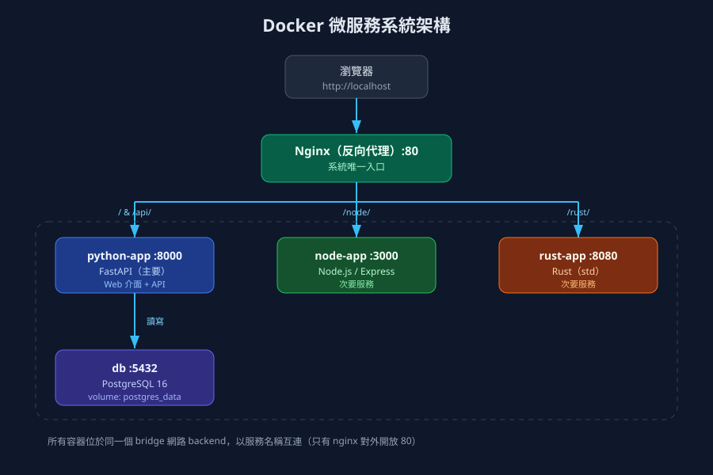
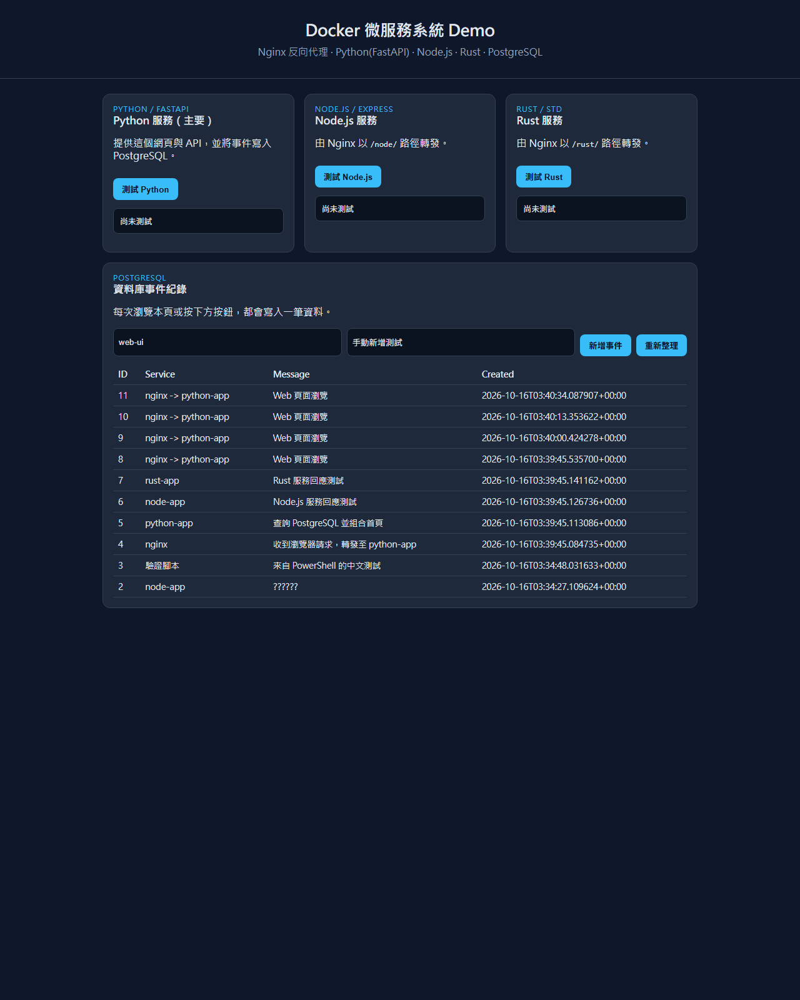

# 課程：現代軟體工程 -- 學生作業與專案

欄位 | 內容
-----|--------
學期 | 115 學年上學期
教師 | [陳鍾誠](https://www.nqu.edu.tw/educsie/index.php?act=blog&code=list&ids=4)
學校 | [金門大學資訊工程系](https://www.nqu.edu.tw/educsie/index.php)
學生 | 謝宛玲
學號 | 111410508

## 作業與專案

111410508 謝宛玲

第幾週 | 習題內容 | 有上課且準時繳交 | 補交且附上請假證明 | 作業連結
-------|---------|-----------------|-----------------|------------
1 | curl | 是 | | [curl](https://github.com/W0X-1201/_se/tree/main/Homework/Hw1)
2 | 校務系統 | 是 | | [校務系統](https://github.com/W0X-1201/_se/tree/main/Homework/Hw2)
3 | 有價值專案 | 是 | | [有價值專案](https://github.com/W0X-1201/_se/tree/main/Homework/Hw3)
4 | git flow | 否 | [是（見下方）](#第-4-週請假證明) | [git flow](https://github.com/W0X-1201/_se/tree/main/Homework/Hw4)
5 | (放假) | 無 | |
6 | docker | 是 | | [docker](https://github.com/W0X-1201/_se/tree/main/Homework/Hw5)
7 | 網站測試 | 是 | | [網站測試](https://github.com/W0X-1201/_se/tree/main/Homework/Hw6)
8 | 有價值專案 | 是 | | [有價值專案](https://github.com/W0X-1201/_se/tree/main/Homework/Hw7%28week8%29)
9 | cloudflare 網站專案 | 是 | | [cloudflare網站專案](<https://github.com/W0X-1201/_se/tree/main/Homework/Hw8(week9)>)

---

### 第 4 週請假證明

---

## 系統展示（Hw5 微服務系統）

