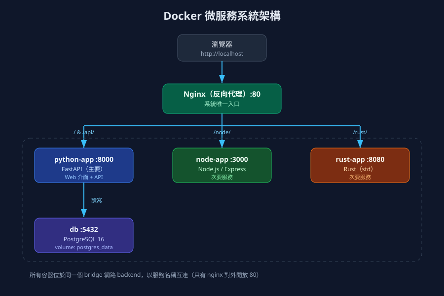
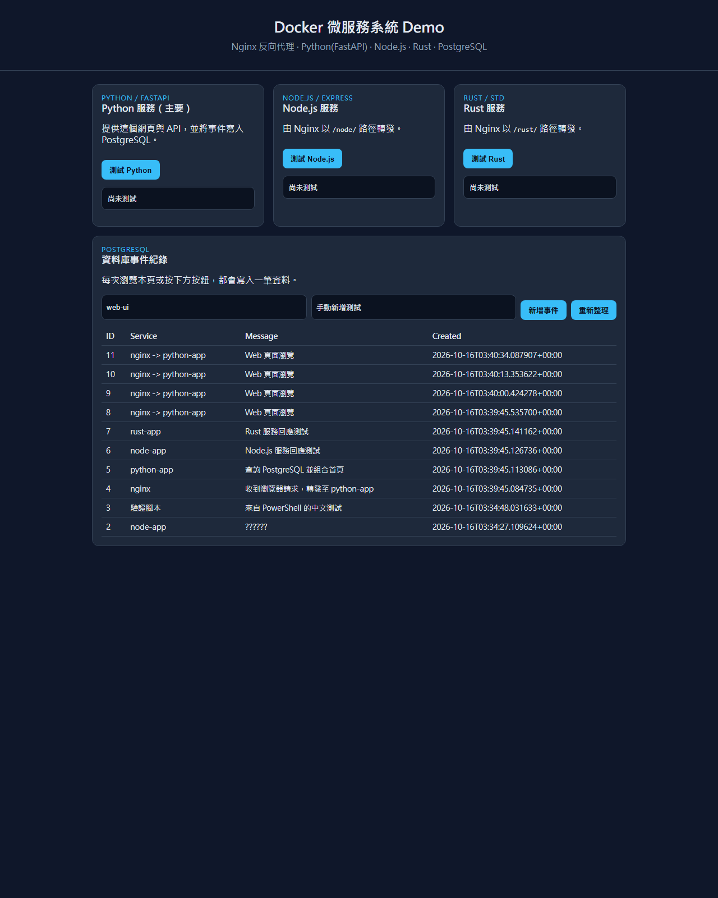

# 課程：現代軟體工程 -- 學生作業與專案

欄位 | 內容
-----|--------
學期 | 115 學年上學期
教師 | [陳鍾誠](https://www.nqu.edu.tw/educsie/index.php?act=blog&code=list&ids=4)
學校 | [金門大學資訊工程系](https://www.nqu.edu.tw/educsie/index.php)
學生 | 謝宛玲
學號 | 08

## 作業與專案

作業 | 專案 | 說明
-----|------|-----
[Hw1](Homework/Hw1/) | [rcurl](Homework/Hw1/) | 用 Rust 手寫 HTTP/1.1 的類 curl 命令列工具，支援 HTTPS、POST/JSON、302 導向、gzip、基本認證與 curl 相容退出碼
[Hw2](Homework/Hw2/) | [NQU 校務資訊系統](Homework/Hw2/) | 前端 → 後端 → 資料庫三層架構的大學校務系統，涵蓋學生、教師、管理員三種角色的完整流程
[Hw3](Homework/Hw3/) | [OmniStock AI](Homework/Hw3/) | 智慧股票資產管理平台，串接 Yahoo Finance 即時報價與 Google News RSS 的三層架構應用
[Hw4](Homework/Hw4/) | [Git / GitHub 操作說明](Homework/Hw4/) | 分支建立、合併、Fork 與 Pull Request 的完整操作指南
[Hw5](Homework/Hw5/) | [Docker 學習紀錄與微服務系統](Homework/Hw5/) | Docker 核心觀念與常用指令，含 Dockerfile、Volume、Network、Compose，以及 Nginx＋PostgreSQL＋Python/Node.js/Rust 的多語言微服務系統

## 系統展示（Hw5 微服務系統）

